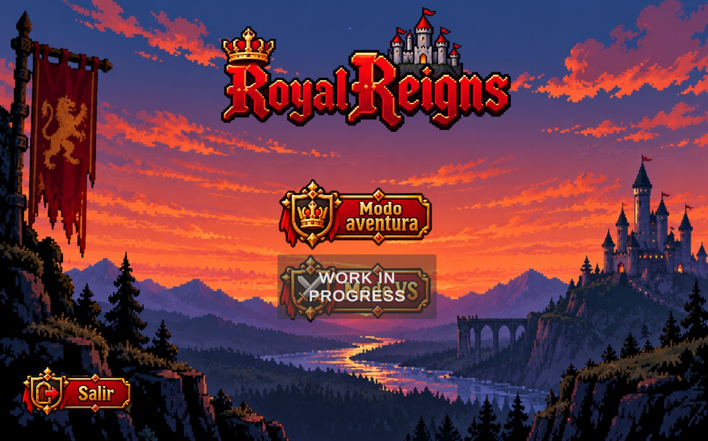
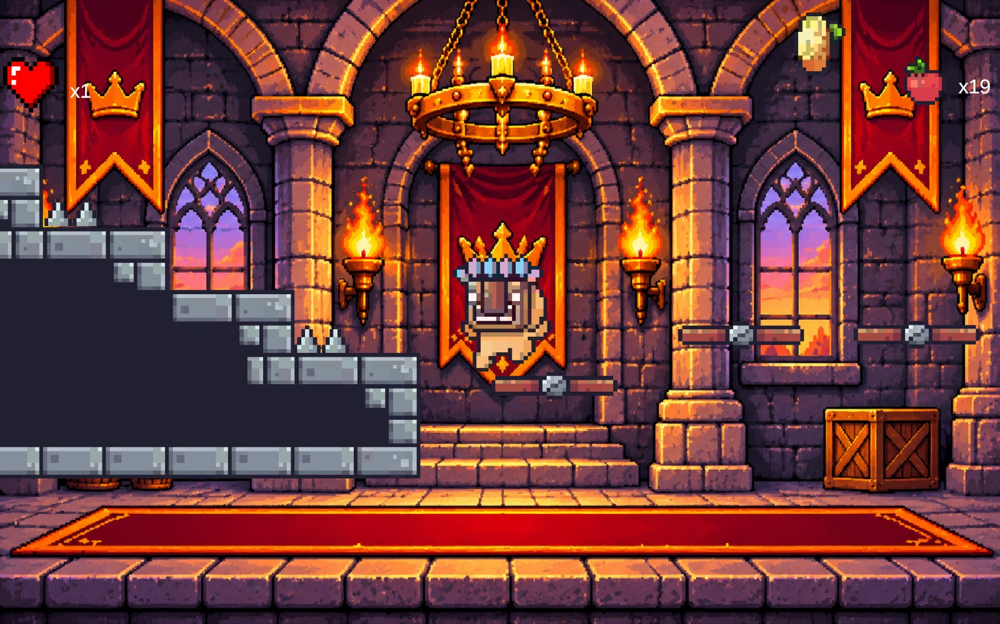
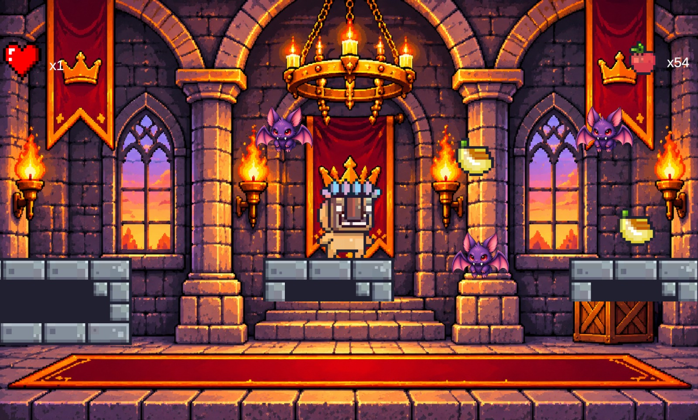
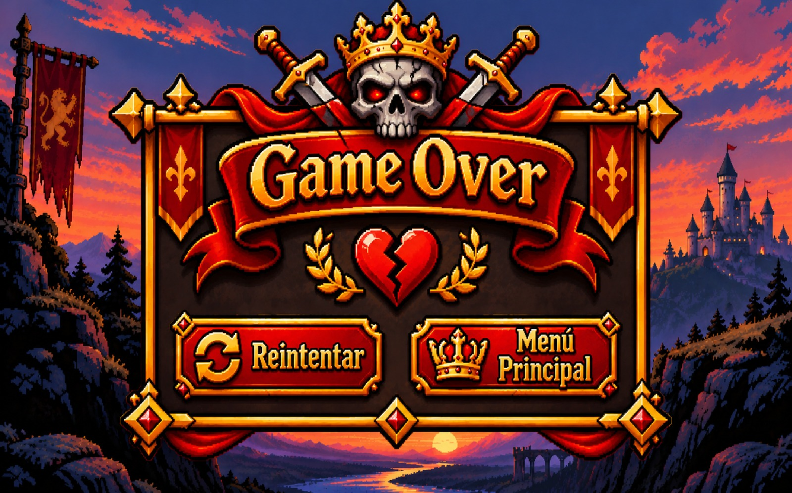

# Proyecto 2D - Royal Reigns

## Sergey Baghdasaryan Urutyan

## ¿De que vá?

Es un juego de plataformas donde el personaje principal es el bufón que debe entretener al rey atravesando tres caminos llenos de trampas mientras intenta recoger la mayor cantidad de frutas posible.

## Imágenes

### Pantalla de inicio

### Niveles

### Pantalla final

